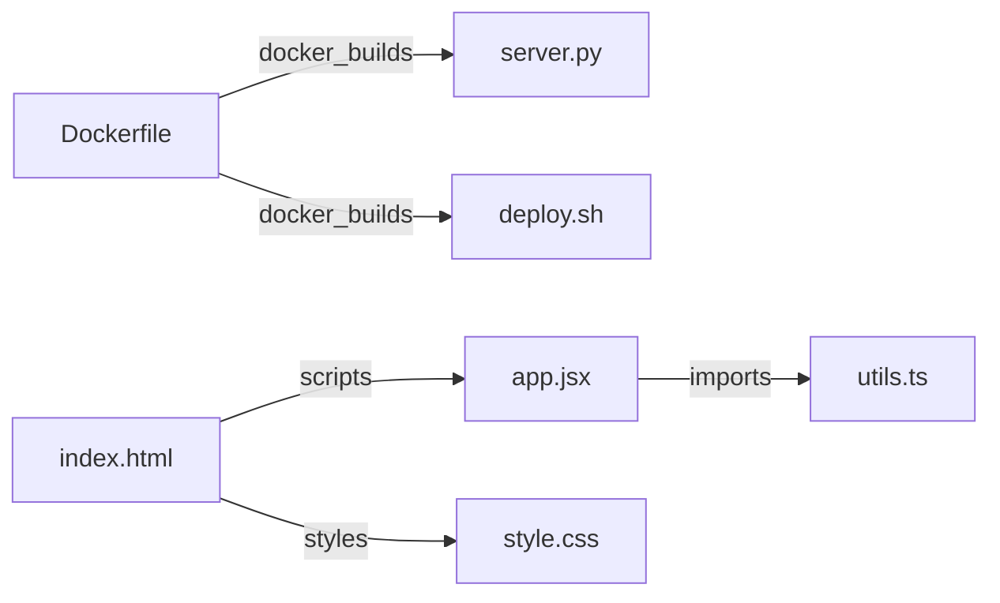

# Comprehensive Codebase & Architecture Dossier: `samples`
> **Engine Used**: Rule/AST Deep Knowledge Engine (Deterministic Zero-AI Mode)  
> **Scope**: 10 files | 293 lines of code | 5 interconnections
---
## 1. Architecture & Tech Stack Ecosystem
### Architectural Style: **Single Page Application (SPA) / Frontend Component Architecture**
The project implements a modern client-side Single Page Application architecture. Components are organized hierarchically, allowing rapid declarative DOM updates via the Virtual DOM and encapsulated CSS styling.

### Technology Compatibility Analysis
**Multi-Language Ecosystem**: The codebase is composed of Dockerfile (1 files), Java (1 files), JavaScript (JSX/React) (1 files), Shell Script (1 files), Rust (1 files), Go (1 files), HTML (1 files), Python (1 files), CSS (1 files), TypeScript (1 files). The frontend leverages modern React declarative components for high-fidelity interactive state management. Styling is streamlined using atomic utility classes compiled ahead of time for minimal production bundle footprint. Environment parity is guaranteed through Docker containerization, ensuring deterministic deployment across local and cloud targets.

| Category | Detected Technologies & Tooling |
| :--- | :--- |
| **Languages** | `Dockerfile` (1 files), `Java` (1 files), `JavaScript (JSX/React)` (1 files), `Shell Script` (1 files), `Rust` (1 files), `Go` (1 files), `HTML` (1 files), `Python` (1 files), `CSS` (1 files), `TypeScript` (1 files) |
| **Frameworks** | `CLI / Tooling Automation (python)`, `Docker Engine Containerization`, `Go Standard net/http`, `Pydantic Data Validation`, `React / Modern SPA Mount Point`, `React.js`, `Tailwind CSS Utilities` |
| **Build Tools** | `Docker Container Engine` |
| **Runtimes** | `OCI Containerized Sandbox` |

---
## 2. Directory Hierarchy & Subsystem Roles
| Directory / Subsystem | Purpose & Architectural Role |
| :--- | :--- |
| `root/` | Repository Scaffolding, Package Manifests & Environment Configs |

---
## 3. Cross-File Interconnections & Dependency Graph

### Detailed Interconnection Rationale (How & Why They Work)

#### 🔗 `Dockerfile` ➔ `server.py` (`docker_builds`)
- **Code Reference**: `server.py`
- **How It Works**: The Dockerfile copies `server.py` into the container filesystem via `COPY` or `ADD`. Creates an immutable container layer containing the code needed for runtime execution.
- **Why It Works**: Isolates the application runtime environment, ensuring identical deployment regardless of host OS dependencies.

#### 🔗 `Dockerfile` ➔ `deploy.sh` (`docker_builds`)
- **Code Reference**: `deploy.sh`
- **How It Works**: The Dockerfile copies `deploy.sh` into the container filesystem via `COPY` or `ADD`. Creates an immutable container layer containing the code needed for runtime execution.
- **Why It Works**: Isolates the application runtime environment, ensuring identical deployment regardless of host OS dependencies.

#### 🔗 `app.jsx` ➔ `utils.ts` (`imports`)
- **Code Reference**: `./utils.ts`
- **How It Works**: `app.jsx` imports symbols from `utils.ts` using module syntax `./utils.ts`. The bundler or module loader resolves the file export dictionary and binds exported components or functions into the caller's local scope.
- **Why It Works**: Enforces clean separation of concerns: `utils.ts` encapsulates reusable UI or business logic, allowing `app.jsx` to compose it without code duplication.

#### 🔗 `index.html` ➔ `style.css` (`styles`)
- **Code Reference**: `style.css`
- **How It Works**: The HTML document references `style.css` via `<link rel='stylesheet' href='style.css'>`. The browser engine dispatches an HTTP request, parses the CSS rules, and constructs the CSSOM (CSS Object Model).
- **Why It Works**: Applies visual presentation, responsive layouts, color themes, and typography to the DOM nodes defined in `index.html`.

#### 🔗 `index.html` ➔ `app.jsx` (`scripts`)
- **Code Reference**: `app.jsx`
- **How It Works**: The HTML file loads `app.jsx` via `<script src='app.jsx'>`. The browser script engine compiles and executes the bundle, attaching event listeners and mounting dynamic views into the DOM.
- **Why It Works**: Transforms the static HTML scaffold into an interactive application, initializing state management and dynamic UI lifecycle.

---
## 4. Deep File-by-File Analysis & Pedagogical Breakdown

### 📄 File: `Dockerfile`
- **Language**: `Dockerfile`
- **Size**: 18 lines (317 bytes)
- **Codebase Role**: Containerization, Environment Isolation & Deployment Blueprint
- **Executive Summary**: Dockerfile defining container image build specifications. Uses a multi-stage build across 2 distinct stages to minimize image size. Base image: `python:3.12-slim AS builder`. Exposes network port(s): 8000. Injects 3 file/directory asset(s) from host context.
- **Concepts Identified**: Multi-Stage Build Pipeline (2 stages), Exposed Network Ports (8000), Filesystem Context Injection (3 COPY operations)
- **Frameworks / Libraries**: Docker Engine Containerization

**File Dependencies**:
- ➡️ *Depends on* `server.py` (docker_builds)
- ➡️ *Depends on* `deploy.sh` (docker_builds)

#### Elements, Tags & Components in `Dockerfile`

| Element | Kind | Line | What It Is & How It's Used | Where It's Used | Why It Works & Best Practice |
| :--- | :--- | :--- | :--- | :--- | :--- |
| `Directive: FROM` | directive | 2 | **What:** Initializes a new build stage and sets the foundational base image for subsequent instructions. **How:** Executed at line 2 with arguments: `python:3.12-slim AS builder`. | Instruction in build stage at line 2. | **Why:** Docker downloads the base image layers from the container registry (e.g., Docker Hub), providing the kernel filesystem and OS libraries. **Best Practice:** Use minimal, pinned base images (e.g. `node:20-alpine` or `python:3.12-slim`) rather than generic `latest` tags. |
| `Directive: WORKDIR` | directive | 4 | **What:** Sets the working directory for any following `RUN`, `CMD`, `ENTRYPOINT`, `COPY`, and `ADD` instructions. **How:** Executed at line 4 with arguments: `/app`. | Instruction in build stage at line 4. | **Why:** Creates the directory if it does not exist and ensures all relative file paths execute inside this safe container directory. **Best Practice:** Always set an absolute `WORKDIR` (e.g., `/app`) instead of relying on default container root directories. |
| `Directive: COPY` | directive | 5 | **What:** Copies files or directories from the local build context into the container filesystem. **How:** Executed at line 5 with arguments: `server.py .`. | Instruction in build stage at line 5. | **Why:** Each `COPY` creates an immutable image layer. Docker caches layers; if files have not changed, Docker reuses cached build layers. **Best Practice:** Copy package manifest files (`package.json`, `requirements.txt`) before copying source code to maximize Docker cache utilization. |
| `Directive: RUN` | directive | 7 | **What:** Executes shell commands during container build time, committing the resulting filesystem changes into a new image layer. **How:** Executed at line 7 with arguments: `pip install --no-cache-dir pydantic`. | Instruction in build stage at line 7. | **Why:** Commonly used for installing packages, compiling code, or building production frontend assets. **Best Practice:** Chain related commands with `&&` and clean up package manager caches (`rm -rf /var/lib/apt/lists/*`) in the same layer to minimize image size. |
| `Directive: EXPOSE` | directive | 17 | **What:** Documentation directive informing Docker that the container listens on the specified network ports at runtime. **How:** Executed at line 17 with arguments: `8000`. | Instruction in build stage at line 17. | **Why:** Does not actually publish ports automatically; it serves as metadata for container runtimes and human operators. **Best Practice:** Always pair with `-p <host>:<container>` during `docker run` or port definitions in `docker-compose.yml`. |
| `Directive: ENTRYPOINT` | directive | 18 | **What:** Configures a container that will run as an executable, defining the default executable process. **How:** Executed at line 18 with arguments: `["./deploy.sh"]`. | Instruction in build stage at line 18. | **Why:** Unlike `CMD`, `ENTRYPOINT` is not easily overridden by CLI arguments; arguments passed to `docker run` are appended to the entrypoint. **Best Practice:** Use the exec JSON format (`ENTRYPOINT ["python", "app.py"]`) so Unix signals (SIGTERM) pass directly to the main process. |

---
### 📄 File: `Service.java`
- **Language**: `Java`
- **Size**: 19 lines (449 bytes)
- **Codebase Role**: Java Enterprise Backend Service / JVM Component
- **Executive Summary**: Java source file in package `com.cloudsphere.analytics` declaring 1 class(es), 0 interface(s), and using 2 imports. 
- **Concepts Identified**: Java Class OOP Structure (Service)

#### Elements, Tags & Components in `Service.java`

| Element | Kind | Line | What It Is & How It's Used | Where It's Used | Why It Works & Best Practice |
| :--- | :--- | :--- | :--- | :--- | :--- |
| `class Service` | class | - | **What:** Java class `Service` defined in package `com.cloudsphere.analytics`. **How:** Forms a core object-oriented building block compiled to JVM bytecode. | Belongs to package `com.cloudsphere.analytics`. | **Why:** Executed by the JVM with automatic garbage collection and runtime classloading. **Best Practice:** Maintain strong encapsulation with private fields and descriptive method contracts. |

---
### 📄 File: `app.jsx`
- **Language**: `JavaScript (JSX/React)`
- **Size**: 36 lines (917 bytes)
- **Codebase Role**: React View Component & Interactive UI Controller
- **Executive Summary**: JavaScript (JSX/React) module containing 2 external/internal import references and exporting 1 symbol(s) (Dashboard). Declares 1 UI component(s): Dashboard. Utilizes 2 React hook type(s): useState, useEffect. Features asynchronous promise and fetch workflows. 
- **Concepts Identified**: React State & Hooks Architecture (useState, useEffect), Modular React Component Hierarchy (Dashboard), Asynchronous Data Pipelines (Promises / async-await)
- **Frameworks / Libraries**: React.js

**File Dependencies**:
- ➡️ *Depends on* `utils.ts` (imports)
- ⬅️ *Referenced by* `index.html` (scripts)

#### Elements, Tags & Components in `app.jsx`

| Element | Kind | Line | What It Is & How It's Used | Where It's Used | Why It Works & Best Practice |
| :--- | :--- | :--- | :--- | :--- | :--- |
| `Hook: useState()` | hook | 5 | **What:** A React Hook declaring a state variable and an updater function that triggers component re-rendering when changed. **How:** Invoked 2 time(s) to manage state or lifecycle. | First invoked around line 5. | **Why:** React preserves state between renders by tracking hook call order within the component's internal fiber node. Updating state schedules a reconciliation pass. **Best Practice:** Never mutate state objects or arrays directly; always return new references (e.g. `[...items, newItem]`) to trigger accurate shallow equality checks. |
| `Hook: useEffect()` | hook | 8 | **What:** A React Hook synchronizing the component with external systems (APIs, DOM timers, WebSockets, event listeners). **How:** Invoked 1 time(s) to manage state or lifecycle. | First invoked around line 8. | **Why:** Runs asynchronously after DOM paint. React compares values in the dependency array: if any reference has changed, the previous cleanup function is executed, followed by the new effect. **Best Practice:** Always declare every reactive value used inside the effect in the dependency array, and return a cleanup function to prevent memory leaks. |
| `Component: <Dashboard />` | component | 4 | **What:** Declarative React UI component `<Dashboard />` encapsulating presentation and interactive behavior. **How:** Receives props, maintains local state, and returns a JSX Virtual DOM subtree. | Defined at line 4. | **Why:** React instantiates a fiber node for this component, executing render and reconciliation algorithms whenever inputs change. **Best Practice:** Keep components focused on a single UI responsibility. Extract pure business logic into custom hooks or utility helpers. |
| `Async / Await Flow` | concept | - | **What:** Syntactic sugar built on top of JavaScript Promises for writing asynchronous code sequentially. **How:** Pauses execution non-blockingly while network or async tasks resolve. | Found in data retrieval, effect handlers, or API endpoints. | **Why:** The JavaScript engine pauses execution of the async generator function while awaiting the Promise, yielding execution back to the event loop so the UI doesn't freeze. **Best Practice:** Always wrap await calls in `try...catch` blocks or attach `.catch()` handlers to handle network failures cleanly. |

---
### 📄 File: `deploy.sh`
- **Language**: `Shell Script`
- **Size**: 16 lines (288 bytes)
- **Codebase Role**: Build, Automation, CI/CD or Deployment Task Runner
- **Executive Summary**: Shell automation script containing 16 lines. Targets interpreter: `#!/usr/bin/env bash`. Enforces strict error trapping. Defines 2 modular shell routine(s): log_info, start_application. Orchestrates command-line tools: python. Sources 0 child configuration/script file(s).
- **Concepts Identified**: Interpreter Shebang (`#!/usr/bin/env bash`), Strict Shell Safety Mode (`set -e / pipefail`), Modular Shell Functions (log_info, start_application), Orchestrated External Tooling (python)
- **Frameworks / Libraries**: CLI / Tooling Automation (python)

**File Dependencies**:
- ⬅️ *Referenced by* `Dockerfile` (docker_builds)

#### Elements, Tags & Components in `deploy.sh`

| Element | Kind | Line | What It Is & How It's Used | Where It's Used | Why It Works & Best Practice |
| :--- | :--- | :--- | :--- | :--- | :--- |
| `Shebang Interpreter` | directive | 1 | **What:** The first line of an executable script starting with `#!` indicating the interpreter path. **How:** Instructs the OS kernel which binary executes this script file. | First line of the script. | **Why:** The operating system kernel examines the initial bytes (magic numbers 0x23 0x21) to invoke the specified binary (e.g. `/bin/bash` or `/usr/bin/env bash`). **Best Practice:** Use `#!/usr/bin/env bash` for maximum portability across Unix and Linux distributions. |
| `Strict Mode Flag` | concept | - | **What:** Common shell safeguard flags: `set -euo pipefail`. **How:** Configures bash runtime to fail fast on any error. | Initialization section of the script. | **Why:** Enforces immediate script exit on command error (`-e`), treats unset variables as errors (`-u`), and fails pipelines if any stage fails (`-o pipefail`). **Best Practice:** Place `set -euo pipefail` at the start of every production shell script to prevent catastrophic partial script execution. |

---
### 📄 File: `engine.rs`
- **Language**: `Rust`
- **Size**: 35 lines (710 bytes)
- **Codebase Role**: Rust Systems Service / High-Performance Core Engine
- **Executive Summary**: Rust module declaring 1 struct(s), 1 enum(s), 1 trait(s), and 3 function(s). Uses 2 crate/module imports.
- **Concepts Identified**: Data Structures (ClusterNode), Algebraic Data Types / Enums (HealthStatus), Trait Abstractions (NodeEvaluator), Async Tokio Runtime & Concurrency

#### Elements, Tags & Components in `engine.rs`

| Element | Kind | Line | What It Is & How It's Used | Where It's Used | Why It Works & Best Practice |
| :--- | :--- | :--- | :--- | :--- | :--- |
| `struct ClusterNode` | struct | - | **What:** Rust custom data struct `ClusterNode` defining memory layout and fields. **How:** Provides strict, type-safe data modeling with zero runtime overhead. | Declared in this module to represent core state or domain entities. | **Why:** Rust guarantees memory safety without garbage collection via ownership rules and compile-time borrowing checks. **Best Practice:** Derive standard traits like `#[derive(Debug, Clone, PartialEq)]` where appropriate. |
| `fn check_health()` | function | - | **What:** Rust function `check_health` implementing typed computation. **How:** Performs modular operations according to Rust's strict ownership contracts. | Declared at the module or impl block level. | **Why:** Compiled down to native machine code with LLVM optimizations and zero-cost abstractions. **Best Practice:** Return `Result<T, E>` for recoverable errors rather than panicking. |
| `fn check_health()` | function | - | **What:** Rust function `check_health` implementing typed computation. **How:** Performs modular operations according to Rust's strict ownership contracts. | Declared at the module or impl block level. | **Why:** Compiled down to native machine code with LLVM optimizations and zero-cost abstractions. **Best Practice:** Return `Result<T, E>` for recoverable errors rather than panicking. |
| `fn run_monitoring_engine()` | function | - | **What:** Rust function `run_monitoring_engine` implementing typed computation. **How:** Performs modular operations according to Rust's strict ownership contracts. | Declared at the module or impl block level. | **Why:** Compiled down to native machine code with LLVM optimizations and zero-cost abstractions. **Best Practice:** Return `Result<T, E>` for recoverable errors rather than panicking. |

---
### 📄 File: `handler.go`
- **Language**: `Go`
- **Size**: 34 lines (586 bytes)
- **Codebase Role**: Go Cloud Microservice / High-Performance Backend Routine
- **Executive Summary**: Go file in package `main` with 1 struct(s), 1 interface(s), and 1 function(s). Uses 3 package imports. Features lightweight goroutine concurrency. 
- **Concepts Identified**: Go Composite Structs (TelemetryPayload), Implicit Go Interfaces (TelemetryStore), CSP Concurrency (Goroutines & Channels)
- **Frameworks / Libraries**: Go Standard net/http

#### Elements, Tags & Components in `handler.go`

| Element | Kind | Line | What It Is & How It's Used | Where It's Used | Why It Works & Best Practice |
| :--- | :--- | :--- | :--- | :--- | :--- |
| `type TelemetryPayload struct` | struct | - | **What:** Go struct `TelemetryPayload` defining a typed data container. **How:** Stores state and serves as receiver for associated Go methods. | Part of package `main`. | **Why:** Allocated contiguously in memory for minimal cache misses and fast GC scanning. **Best Practice:** Use struct tags (`json:"name"`) to govern serialization. |
| `func HandleMetrics()` | function | - | **What:** Go function or method `HandleMetrics`. **How:** Executes explicit, procedural logic with explicit error checking. | Defined in package `main`. | **Why:** Compiled to statically-linked native binary with an embedded Go runtime. **Best Practice:** Always check returned `err` values immediately (`if err != nil`). |

---
### 📄 File: `index.html`
- **Language**: `HTML`
- **Size**: 38 lines (1,201 bytes)
- **Codebase Role**: Application Presentation & DOM Root Entrypoint
- **Executive Summary**: HTML document containing 25 elements across 18 distinct tag types. Serves as the visual entrypoint or template. Configured as a React/SPA application mount point. References 1 stylesheet(s) and 1 script bundle(s).
- **Concepts Identified**: External Stylesheets (1 referenced), External Script Bundles (1 referenced), Single Page Application (SPA) DOM Anchor
- **Frameworks / Libraries**: Tailwind CSS Utilities, React / Modern SPA Mount Point
- **Design & Styling Architecture**: Links 1 external stylesheet(s). Utilizes Tailwind utility classes in markup. 

**File Dependencies**:
- ➡️ *Depends on* `style.css` (styles)
- ➡️ *Depends on* `app.jsx` (scripts)

#### Elements, Tags & Components in `index.html`

| Element | Kind | Line | What It Is & How It's Used | Where It's Used | Why It Works & Best Practice |
| :--- | :--- | :--- | :--- | :--- | :--- |
| `<html>` | tag | 2 | **What:** The root element of an HTML document representing the top-level container. **How:** Defined in the markup to structure content. Count in file: 1. | Used 1 time(s) across the document.  | **Why:** The browser parser uses <html> to initialize the DOM (Document Object Model) tree. The 'lang' attribute specifies the human language for screen readers and search engines. **Best Practice:** Always specify a valid 'lang' attribute (e.g. lang='en') to ensure accessibility compliance and proper hyphenation/translation. |
| `<head>` | tag | 3 | **What:** The container for document metadata that is not directly rendered on the page canvas. **How:** Defined in the markup to structure content. Count in file: 1. | Used 1 time(s) across the document.  | **Why:** The browser reads <head> synchronously to load external stylesheets, fonts, set viewport rules, and parse meta tags before initial paint, preventing flash of unstyled content (FOUC). **Best Practice:** Place charset and viewport meta tags near the very top of <head> so the parser configures text encoding and mobile scaling immediately. |
| `<meta>` | tag | 4 | **What:** Provides structured document-level metadata not expressible by other head elements. **How:** Defined in the markup to structure content. Count in file: 3. | Used 3 time(s) across the document.  | **Why:** Configures responsive viewport rendering (<meta name='viewport'>), character encoding (UTF-8), SEO descriptions, and OpenGraph social cards. **Best Practice:** Include <meta name='viewport' content='width=device-width, initial-scale=1.0'> on every responsive web page. |
| `<title>` | tag | 7 | **What:** Standard HTML5 element `<title>` providing document structure or markup styling. **How:** Defined in the markup to structure content. Count in file: 1. | Used 1 time(s) across the document.  | **Why:** Parsed by the browser engine into DOM elements for styling, positioning, and script access. **Best Practice:** Ensure proper closing tags and valid semantic hierarchy. |
| `<link>` | tag | 8 | **What:** Specifies external resource relationships (stylesheets, preloaded fonts, favicons, canonical URLs). **How:** Defined in the markup to structure content. Count in file: 2. | Used 2 time(s) across the document. Imports stylesheets/resources: style.css.  | **Why:** Allows the browser engine to fetch critical external CSS and fonts. Rel='preload' instructs high-priority fetching ahead of DOM discovery. **Best Practice:** Use rel='preload' for critical hero fonts or LCP images, and rel='preconnect' for external asset domains. |
| `<body>` | tag | 11 | **What:** The document's primary renderable canvas containing all visual content, widgets, and layout structures. **How:** Defined in the markup to structure content. Count in file: 1. | Used 1 time(s) across the document.  | **Why:** Parsing the <body> builds the visible DOM elements. As elements are parsed, the browser computes CSSOM attachments to generate the render tree. **Best Practice:** Keep the DOM tree reasonably flat; deep nesting (>32 levels) causes significant style recalculation and layout thrashing. |
| `<header>` | tag | 12 | **What:** A semantic landmark element representing introductory content or a set of navigational links. **How:** Defined in the markup to structure content. Count in file: 1. | Used 1 time(s) across the document.  | **Why:** Screen readers expose <header> as an ARIA 'banner' landmark (when top-level), allowing assistive technology users to jump directly to primary site navigation. **Best Practice:** Use <header> at the page level or within <article>/<section> to group titles, logos, and search bars. Avoid nesting <header> inside <footer>. |
| `<nav>` | tag | 13 | **What:** A semantic landmark designating a section of major navigational links. **How:** Defined in the markup to structure content. Count in file: 1. | Used 1 time(s) across the document.  | **Why:** Assistive software maps <nav> to the 'navigation' landmark role, enabling keyboard shortcuts to skip repetitive content and reach links immediately. **Best Practice:** Reserve <nav> for primary navigation blocks (menus, paginations, breadcrumbs). Do not wrap all links in <nav>. |
| `
` | tag | 14 | **What:** The generic block-level flow container with no inherent semantic meaning. **How:** Defined in the markup to structure content. Count in file: 2. | Used 2 time(s) across the document. Contains the primary React/SPA root mount point (`#root`).  | **Why:** Provides a clean hook for CSS styling (Flexbox, CSS Grid, absolute positioning) and JavaScript manipulation without imposing accessibility semantics. **Best Practice:** Do not use 
 for interactive buttons or links; prefer native semantic elements (<button>, <a>) to retain keyboard focus and accessibility roles. |
| `<ul>` | tag | 15 | **What:** Standard HTML5 element `<ul>` providing document structure or markup styling. **How:** Defined in the markup to structure content. Count in file: 1. | Used 1 time(s) across the document.  | **Why:** Parsed by the browser engine into DOM elements for styling, positioning, and script access. **Best Practice:** Ensure proper closing tags and valid semantic hierarchy. |
| `<li>` | tag | 16 | **What:** Standard HTML5 element `<li>` providing document structure or markup styling. **How:** Defined in the markup to structure content. Count in file: 2. | Used 2 time(s) across the document.  | **Why:** Parsed by the browser engine into DOM elements for styling, positioning, and script access. **Best Practice:** Ensure proper closing tags and valid semantic hierarchy. |
| `<a>` | tag | 16 | **What:** Standard HTML5 element `<a>` providing document structure or markup styling. **How:** Defined in the markup to structure content. Count in file: 2. | Used 2 time(s) across the document.  | **Why:** Parsed by the browser engine into DOM elements for styling, positioning, and script access. **Best Practice:** Ensure proper closing tags and valid semantic hierarchy. |
| `<main>` | tag | 22 | **What:** The dominant, unique central content area of the document body. **How:** Defined in the markup to structure content. Count in file: 1. | Used 1 time(s) across the document.  | **Why:** Mapped to the ARIA 'main' landmark. There should only be one non-hidden <main> per document so users can skip repeated headers and sidebars. **Best Practice:** Never include repeated headers, copyright notices, search banners, or global sidebars directly in <main>. |
| `<section>` | tag | 23 | **What:** A generic standalone thematic grouping of content, typically with an introductory heading. **How:** Defined in the markup to structure content. Count in file: 1. | Used 1 time(s) across the document.  | **Why:** Creates a distinct logical region in the document outline, assisting both search engine indexers and accessibility navigation. **Best Practice:** Always include a descriptive heading (<h2>-<h6>) within a <section> to identify its purpose. |
| `<h1>` | tag | 24 | **What:** Standard HTML5 element `<h1>` providing document structure or markup styling. **How:** Defined in the markup to structure content. Count in file: 1. | Used 1 time(s) across the document.  | **Why:** Parsed by the browser engine into DOM elements for styling, positioning, and script access. **Best Practice:** Ensure proper closing tags and valid semantic hierarchy. |
| `
` | tag | 25 | **What:** Standard HTML5 element `
` providing document structure or markup styling. **How:** Defined in the markup to structure content. Count in file: 2. | Used 2 time(s) across the document.  | **Why:** Parsed by the browser engine into DOM elements for styling, positioning, and script access. **Best Practice:** Ensure proper closing tags and valid semantic hierarchy. |
| `<footer>` | tag | 32 | **What:** A semantic container for concluding information about its nearest sectioning parent or the page. **How:** Defined in the markup to structure content. Count in file: 1. | Used 1 time(s) across the document.  | **Why:** Mapped to 'contentinfo' landmark role at the document root, housing legal notices, copyright, sitemaps, and contact information. **Best Practice:** Ensure contrast ratios for footer links comply with WCAG AA even when subdued colors are used. |
| `<script>` | tag | 36 | **What:** Embeds executable code or references an external JavaScript file. **How:** Defined in the markup to structure content. Count in file: 1. | Used 1 time(s) across the document. Loads scripts: app.jsx.  | **Why:** By default, scripts block DOM construction. Using 'defer' executes the script after DOM is ready without blocking, while 'async' executes as soon as downloaded. **Best Practice:** Always use 'defer' for client app bundles or 'type=module' which is deferred by default. |

---
### 📄 File: `server.py`
- **Language**: `Python`
- **Size**: 23 lines (703 bytes)
- **Codebase Role**: Domain Model / Object-Oriented Core Service
- **Executive Summary**: Python module containing 3 imports, 2 class definition(s), and 3 function(s). Built with Pydantic Data Validation. Features asynchronous coroutines. 
- **Concepts Identified**: Object-Oriented Architecture (2 classes), Functional / Modular Routines (3 functions), Asyncio Asynchronous Coroutines
- **Frameworks / Libraries**: Pydantic Data Validation

**File Dependencies**:
- ⬅️ *Referenced by* `Dockerfile` (docker_builds)

#### Elements, Tags & Components in `server.py`

| Element | Kind | Line | What It Is & How It's Used | Where It's Used | Why It Works & Best Practice |
| :--- | :--- | :--- | :--- | :--- | :--- |
| `class MetricResponse` | class | 5 | **What:** An object-oriented blueprint for creating user-defined data structures containing state (attributes) and behavior (methods). **How:** Defined at line 5 inherits from `BaseModel`.  | Class blueprint declared at line 5. | **Why:** Instantiating a class invokes `__new__` to allocate memory followed by `__init__` to initialize instance attributes. **Best Practice:** Prefer composition over deep inheritance hierarchies. Use `@dataclass` or Pydantic `BaseModel` for pure data structures. |
| `class ClusterService` | class | 10 | **What:** An object-oriented blueprint for creating user-defined data structures containing state (attributes) and behavior (methods). **How:** Defined at line 10 base class.  | Class blueprint declared at line 10. | **Why:** Instantiating a class invokes `__new__` to allocate memory followed by `__init__` to initialize instance attributes. **Best Practice:** Prefer composition over deep inheritance hierarchies. Use `@dataclass` or Pydantic `BaseModel` for pure data structures. |
| `async def handle_metrics_route()` | function | 20 | **What:** A modular, reusable block of code that accepts input parameters, executes statements, and returns a value. **How:** Defined at line 20.  | Function declared at line 20. | **Why:** Allocates a new stack frame in the Python execution environment for local variables. Supports first-class function passing and closures. **Best Practice:** Adhere to the Single Responsibility Principle: each function should do one thing well and be covered by unit tests. |
| `def __init__()` | function | 11 | **What:** A modular, reusable block of code that accepts input parameters, executes statements, and returns a value. **How:** Defined at line 11.  | Function declared at line 11. | **Why:** Allocates a new stack frame in the Python execution environment for local variables. Supports first-class function passing and closures. **Best Practice:** Adhere to the Single Responsibility Principle: each function should do one thing well and be covered by unit tests. |
| `async def get_system_telemetry()` | function | 14 | **What:** A modular, reusable block of code that accepts input parameters, executes statements, and returns a value. **How:** Defined at line 14.  | Function declared at line 14. | **Why:** Allocates a new stack frame in the Python execution environment for local variables. Supports first-class function passing and closures. **Best Practice:** Adhere to the Single Responsibility Principle: each function should do one thing well and be covered by unit tests. |

---
### 📄 File: `style.css`
- **Language**: `CSS`
- **Size**: 58 lines (1,110 bytes)
- **Codebase Role**: Application Styling, Design System Tokens & Responsive Theme Layer
- **Executive Summary**: CSS stylesheet containing 5 class selectors, 5 ID selectors, and 1 responsive media query breakpoints. Employs modern Flexbox alignment. Features CSS Grid layout templates. Configures centralized CSS custom variables. Defines 1 GPU-accelerated keyframe animations. 
- **Concepts Identified**: Flexbox One-Dimensional Layout Engine, CSS Grid Two-Dimensional Layout Engine, CSS Custom Properties / Design Tokens, Keyframe Animations (fadeIn), Responsive Breakpoints (1 queries)
- **Design & Styling Architecture**: Selector count: 5 classes, 5 IDs. Layout architectures: Flexbox CSS Grid . Design tokens: Yes (CSS Custom Properties). Responsive adaptation: 1 breakpoints.
- **Animations & Motion**: Active motion design layer: 1 @keyframes sequences defined. 2 transition/transform rules for hover, focus, and state animations.

**File Dependencies**:
- ⬅️ *Referenced by* `index.html` (styles)

#### Elements, Tags & Components in `style.css`

| Element | Kind | Line | What It Is & How It's Used | Where It's Used | Why It Works & Best Practice |
| :--- | :--- | :--- | :--- | :--- | :--- |
| `Flexbox (`display: flex`)` | layout | - | **What:** A one-dimensional layout model providing space distribution and alignment along primary and cross axes. **How:** Applied to parent containers to automatically align, distribute, and space child elements. | Found in container and layout rules across the stylesheet. | **Why:** The flex container calculates available space along the main axis ('justify-content') and cross axis ('align-items'), dynamically shrinking or expanding children based on 'flex-grow' and 'flex-shrink'. **Best Practice:** Ideal for navigation bars, item lists, toolbars, and centered modal boxes. Use 'gap' instead of child margins. |
| `CSS Grid (`display: grid`)` | layout | - | **What:** A two-dimensional layout system managing both rows and columns simultaneously. **How:** Establishes explicit rows and columns for structured card matrices and multi-panel dashboards. | Defines the overarching scaffolding and responsive layout grids. | **Why:** Creates explicit tracks using 'grid-template-columns' and 'grid-template-rows'. Elements snap into grid lines or named template areas. **Best Practice:** Use CSS Grid for overall page scaffolding, complex dashboards, multi-column card galleries, and asymmetrical layouts. |
| `CSS Variables (`--custom-properties`)` | concept | - | **What:** CSS Custom Properties (e.g., --primary-color: #3b82f6) that store reusable values cascading throughout the DOM. **How:** Centralizes color palettes, font stacks, and spacing tokens for dynamic theming (e.g. dark/light mode). | Declared in `:root` and consumed with `var(--...)` throughout declarations. | **Why:** Unlike SASS variables, CSS variables are live in the browser runtime and inherit down the DOM tree, enabling instant theme switching (dark/light mode) without recompilation. **Best Practice:** Declare shared design tokens under the ':root' selector and override them inside '[data-theme=dark]' or '.dark' classes. |
| `@keyframes (1 defined)` | animation | - | **What:** Declarative animation sequences controlling intermediate steps in a CSS animation using percentage keyframes. **How:** Declares discrete animation sequences: fadeIn. | Referenced by `animation:` properties on interactive or hero elements. | **Why:** The browser's compositor thread handles GPU-accelerated properties ('transform' and 'opacity') at 60/120fps without triggering expensive CPU layout reflows. **Best Practice:** Stick to animating 'transform' and 'opacity' whenever possible. Use '@media (prefers-reduced-motion: reduce)' to disable motion for sensitive users. |
| `@media Queries (1 rules)` | concept | - | **What:** Conditional CSS rules applying styles depending on device viewport dimensions, pixel density, orientation, or preferences. **How:** Adapts layout rules dynamically when screen width changes between mobile, tablet, and desktop viewports. | Configured breakpoints: (max-width: 768px)... | **Why:** Evaluated continuously by the browser. When the viewport crosses specified thresholds (e.g., min-width: 768px), the matching stylesheet branch overrides earlier styles. **Best Practice:** Follow a mobile-first design strategy using 'min-width' queries to ensure fast baseline rendering on smaller devices. |

---
### 📄 File: `utils.ts`
- **Language**: `TypeScript`
- **Size**: 16 lines (440 bytes)
- **Codebase Role**: JavaScript/TypeScript Logic & Module Utility
- **Executive Summary**: TypeScript module containing 0 external/internal import references and exporting 3 symbol(s) (ClusterMetric, formatLatency, calculateUptime). 
- **Concepts Identified**: Static TypeScript Type Contracts

**File Dependencies**:
- ⬅️ *Referenced by* `app.jsx` (imports)

---
