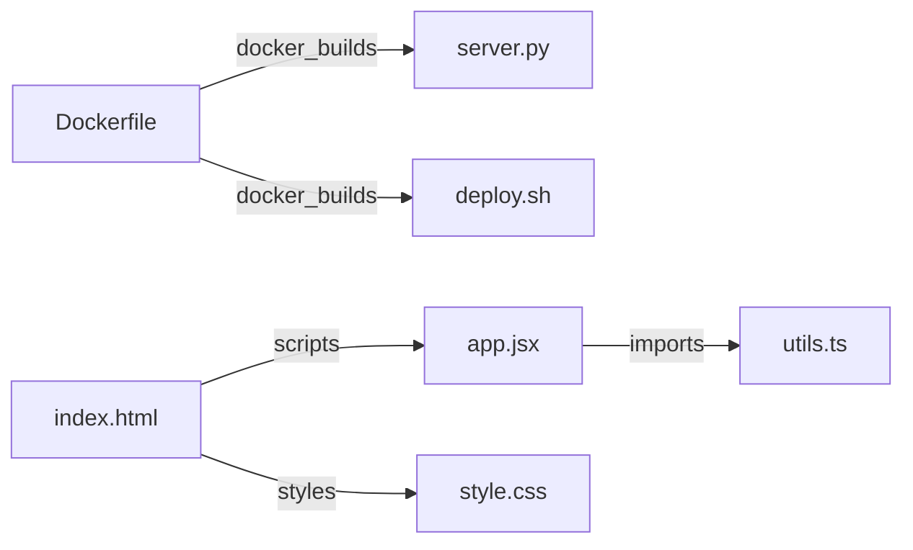

# Comprehensive Codebase & Architecture Dossier: `samples`
> **Engine Used**: Rule/AST Deep Knowledge Engine (Deterministic Zero-AI Mode)  
> **Scope**: 10 files | 293 lines of code | 5 interconnections
---
## 🏰 1. The Big Castle Story (Explain Like I'm 4 Years Old)
> Imagine this entire project `samples` is a giant, bustling Lego castle or toy workshop! There are 10 different Lego pieces working together across 10 languages. Some files build the colorful walls and buttons that you see on screen (frontend), some files are the secret clockwork gears under the floor doing the heavy lifting (backend), and 5 plastic snap-connectors hold them tightly together so when you tap a button on the wall, the gears turn and the doors open smoothly!

---

## 2. Architecture & Tech Stack Ecosystem
### Architectural Style: **Single Page Application (SPA) / Frontend Component Architecture**
The project implements a modern client-side Single Page Application architecture. Components are organized hierarchically, allowing rapid declarative DOM updates via the Virtual DOM and encapsulated CSS styling.

### Technology Compatibility Analysis
**Multi-Language Ecosystem**: The codebase is composed of Dockerfile (1 files), Java (1 files), JavaScript (JSX/React) (1 files), Shell Script (1 files), Rust (1 files), Go (1 files), HTML (1 files), Python (1 files), CSS (1 files), TypeScript (1 files). The frontend leverages modern React declarative components for high-fidelity interactive state management. Styling is streamlined using atomic utility classes compiled ahead of time for minimal production bundle footprint. Environment parity is guaranteed through Docker containerization, ensuring deterministic deployment across local and cloud targets.

## 3. Directory Subsystem Roles
- `root/`: Repository Scaffolding, Package Manifests & Environment Configs

---
## 4. Cross-File Interconnection Graph & Mechanics

#### 🔗 `Dockerfile` ➔ `server.py` (`docker_builds`)
- **How It Works**: The Dockerfile copies `server.py` into the container filesystem via `COPY` or `ADD`. Creates an immutable container layer containing the code needed for runtime execution.
- **Why It Works**: Isolates the application runtime environment, ensuring identical deployment regardless of host OS dependencies.

#### 🔗 `Dockerfile` ➔ `deploy.sh` (`docker_builds`)
- **How It Works**: The Dockerfile copies `deploy.sh` into the container filesystem via `COPY` or `ADD`. Creates an immutable container layer containing the code needed for runtime execution.
- **Why It Works**: Isolates the application runtime environment, ensuring identical deployment regardless of host OS dependencies.

#### 🔗 `app.jsx` ➔ `utils.ts` (`imports`)
- **How It Works**: `app.jsx` imports symbols from `utils.ts` using module syntax `./utils.ts`. The bundler or module loader resolves the file export dictionary and binds exported components or functions into the caller's local scope.
- **Why It Works**: Enforces clean separation of concerns: `utils.ts` encapsulates reusable UI or business logic, allowing `app.jsx` to compose it without code duplication.

#### 🔗 `index.html` ➔ `style.css` (`styles`)
- **How It Works**: The HTML document references `style.css` via `<link rel='stylesheet' href='style.css'>`. The browser engine dispatches an HTTP request, parses the CSS rules, and constructs the CSSOM (CSS Object Model).
- **Why It Works**: Applies visual presentation, responsive layouts, color themes, and typography to the DOM nodes defined in `index.html`.

#### 🔗 `index.html` ➔ `app.jsx` (`scripts`)
- **How It Works**: The HTML file loads `app.jsx` via `` — A script tag loading the JavaScript code from app.jsx. *(🧸 Like inserting the batteries and brain chip into a toy robot so it can move and talk!)* 

---
### 📄 File: `server.py`
- **Language**: `Python` | **Size**: 23 lines (703 bytes)
- **Codebase Role**: Python Source File
> 🧸 **Beginner Story**: Imagine this file `server.py` is a recipe book for a smart kitchen robot! It provides instructions telling the computer how to calculate numbers and prepare data.

- **Executive Summary**: Python module analyzed via pattern recognition.

#### Elements Written in `server.py`
- **Line 1**: `import asyncio` — Brings tools and helpers from the module `asyncio` into this script. *(🧸 Think of this like borrowing a special tool `asyncio` from a friend's toolbox so you can use it here!)* 
- **Line 2**: `import pydantic (BaseModel)` — Brings tools and helpers from the module `pydantic (BaseModel)` into this script. *(🧸 Think of this like borrowing a special tool `pydantic (BaseModel)` from a friend's toolbox so you can use it here!)* 
- **Line 3**: `import typing (Dict, Any)` — Brings tools and helpers from the module `typing (Dict, Any)` into this script. *(🧸 Think of this like borrowing a special tool `typing (Dict, Any)` from a friend's toolbox so you can use it here!)* 
- **Line 5**: `class MetricResponse(BaseModel):` — A blueprint creating `MetricResponse` objects that bundle data and actions together. *(🧸 Think of `class MetricResponse` like a cookie cutter! The class is the cookie cutter blueprint, and every object you make with it is a real cookie with its own sprinkles!)* 
- **Line 10**: `class ClusterService():` — A blueprint creating `ClusterService` objects that bundle data and actions together. *(🧸 Think of `class ClusterService` like a cookie cutter! The class is the cookie cutter blueprint, and every object you make with it is a real cookie with its own sprinkles!)* 
- **Line 20**: `async def handle_metrics_route():` — A named recipe of instructions that takes inputs `()` and calculates an output. *(🧸 Think of `handle_metrics_route` like teaching a robot helper a brand new recipe! Whenever you call `handle_metrics_route`, the robot follows these exact steps and gives you back the result!)* 
- **Line 11**: `def __init__(self, cluster_name):` — A named recipe of instructions that takes inputs `(self, cluster_name)` and calculates an output. *(🧸 Think of `__init__` like teaching a robot helper a brand new recipe! Whenever you call `__init__`, the robot follows these exact steps and gives you back the result!)* 
- **Line 14**: `async def get_system_telemetry(self):` — A named recipe of instructions that takes inputs `(self)` and calculates an output. *(🧸 Think of `get_system_telemetry` like teaching a robot helper a brand new recipe! Whenever you call `get_system_telemetry`, the robot follows these exact steps and gives you back the result!)* 
- **Line 11**: `def __init__(self, cluster_name: str):` — A Python function `__init__` that performs calculations or actions. *(🧸 Think of `__init__` like a helpful robot recipe that runs whenever you call its name!)* 
- **Line 4**: `class MetricResponse(BaseModel):` — A Python class `MetricResponse` structuring data and behaviors. *(🧸 Think of `class MetricResponse` like a cookie cutter blueprint making custom objects!)* 
- **Line 9**: `class ClusterService:` — A Python class `ClusterService` structuring data and behaviors. *(🧸 Think of `class ClusterService` like a cookie cutter blueprint making custom objects!)* 
- **Line 1**: `import asyncio
from pydantic import BaseModel
from typing import Dict, Any

class MetricResponse` — Imports external module `asyncio
from pydantic import BaseModel
from typing import Dict, Any

class MetricResponse`. *(🧸 Think of this like borrowing a tool from another room!)* 

---
### 📄 File: `style.css`
- **Language**: `CSS` | **Size**: 58 lines (1,110 bytes)
- **Codebase Role**: Visual Design Tokens, Layout Styling & Responsive Theming
> 🧸 **Beginner Story**: Imagine your webpage is a paper doll. This CSS file `style.css` is the doll's wardrobe and box of colored crayons! It contains 8 styling rule(s) that paint the background, dress up buttons with curved corners and shadows, and arrange all the furniture in the room so nothing looks messy or cramped.

- **Executive Summary**: Cascading Style Sheet defining 8 style rule(s) across 0 imported assets. Configures Flexbox space distribution. Implements CSS Grid layouts. Declares custom CSS variables. Defines 1 animation sequence(s). Provides 1 responsive breakpoint(s). 

#### Elements Written in `style.css`
- **Line 1**: `:root { --primary-color: #3b82f6; --secondary-color: #10b981; --bg-dark: #090d16; ... }` — CSS styling rule targeting `:root` with 8 property declarations. *(🧸 Think of `:root` like a costume dress-up card! Any element wearing the `:root` label gets painted with these colors and given this exact shape.)* 
- **Line 10**: `body { background-color: var(--bg-dark); color: var(--text-main); font-family: var(--font-base); ... }` — CSS styling rule targeting `body` with 5 property declarations. *(🧸 Think of `body` like a costume dress-up card! Any element wearing the `body` label gets painted with these colors and given this exact shape.)* 
- **Line 18**: `.app-header { display: flex; justify-content: space-between; align-items: center; ... }` — CSS styling rule targeting `.app-header` with 8 property declarations. *(🧸 Think of `.app-header` like a costume dress-up card! Any element wearing the `.app-header` label gets painted with these colors and given this exact shape.)* 
- **Line 29**: `.container { display: grid; grid-template-columns: repeat(auto-fit, minmax(320px, 1fr)); gap: calc(var(--spacing-unit) * 3); padding: calc(var(--spacing-unit) * 3); }` — CSS styling rule targeting `.container` with 4 property declarations. *(🧸 Think of `.container` like a costume dress-up card! Any element wearing the `.container` label gets painted with these colors and given this exact shape.)* 
- **Line 36**: `.hero-banner { animation: fadeIn 0.6s ease-out; }` — CSS styling rule targeting `.hero-banner` with 1 property declarations. *(🧸 Think of `.hero-banner` like a costume dress-up card! Any element wearing the `.hero-banner` label gets painted with these colors and given this exact shape.)* 
- **Line 40**: `@keyframes fadeIn { from {
    opacity: 0; transform: translateY(12px); }` — CSS styling rule targeting `@keyframes fadeIn` with 2 property declarations. *(🧸 Think of `@keyframes fadeIn` like a costume dress-up card! Any element wearing the `@keyframes fadeIn` label gets painted with these colors and given this exact shape.)* 
- **Line 46**: `to { opacity: 1; transform: translateY(0); }` — CSS styling rule targeting `to` with 2 property declarations. *(🧸 Think of `to` like a costume dress-up card! Any element wearing the `to` label gets painted with these colors and given this exact shape.)* 
- **Line 50**: `}

@media (max-width: 768px) { .container {
    grid-template-columns: 1fr; padding: calc(var(--spacing-unit) * 2); }` — CSS styling rule targeting `}

@media (max-width: 768px)` with 2 property declarations. *(🧸 Think of `}

@media (max-width: 768px)` like a costume dress-up card! Any element wearing the `}

@media (max-width: 768px)` label gets painted with these colors and given this exact shape.)* 
- **-**: `display: flex; justify-content: ...; align-items: ...` — A layout engine that arranges items neatly in a single line (row or column). *(🧸 Think of Flexbox like a teacher arranging children in a neat line holding hands, spacing them evenly across the playground!)* 
- **-**: `display: grid; grid-template-columns: ...` — A two-dimensional layout engine managing both rows and columns like a checkerboard. *(🧸 Think of CSS Grid like a giant ice-cube tray or bento box! You give each food item its own special compartment.)* 
- **-**: `--primary-color: #...; --bg-surface: ...;` — Reusable color and size tokens (like `--primary-color: #3b82f6`). *(🧸 Think of a CSS variable like a bucket of blue paint with a label 'MY_FAVORITE_BLUE'. Whenever you want blue, you just point to the bucket!)* 
- **-**: `@keyframes fadeIn { 0% { opacity: 0; } 100% { opacity: 1; } }` — A rule that makes elements move, spin, fade, or bounce over time. *(🧸 Think of @keyframes like a flipbook cartoon! You draw how the toy looks at the start (0%) and end (100%), and the computer flips the pages super fast!)* 
- **-**: `@media (max-width: 768px)...` — Conditional CSS rules applying styles depending on device screen width or orientation. *(🧸 Think of media queries like an outfit changer! When you go outside in the cold (small mobile phone), it puts on a winter jacket, and in the sun (big monitor), it puts on sunglasses!)* 

---
### 📄 File: `utils.ts`
- **Language**: `TypeScript` | **Size**: 16 lines (440 bytes)
- **Codebase Role**: JavaScript/TypeScript Logic & Module Utility
> 🧸 **Beginner Story**: Imagine this file `utils.ts` is a lively workshop in a toy factory! It provides smart tools and helper calculations. Whenever a user touches a button or clicks their mouse on the screen, the functions inside this file wake up, calculate new numbers, and update the screen so the user sees instant magic!

- **Executive Summary**: TypeScript module containing 0 imports, 0 component(s), and 3 exported symbols. 

#### Elements Written in `utils.ts`
- **Line 8**: `function formatLatency(...) { ... }` — JavaScript function `formatLatency` that executes calculations or event handling. *(🧸 Think of `formatLatency` like teaching a robot a recipe! Whenever you call `formatLatency()`, it performs these steps.)* 
- **Line 14**: `function calculateUptime(...) { ... }` — JavaScript function `calculateUptime` that executes calculations or event handling. *(🧸 Think of `calculateUptime` like teaching a robot a recipe! Whenever you call `calculateUptime()`, it performs these steps.)* 

---
