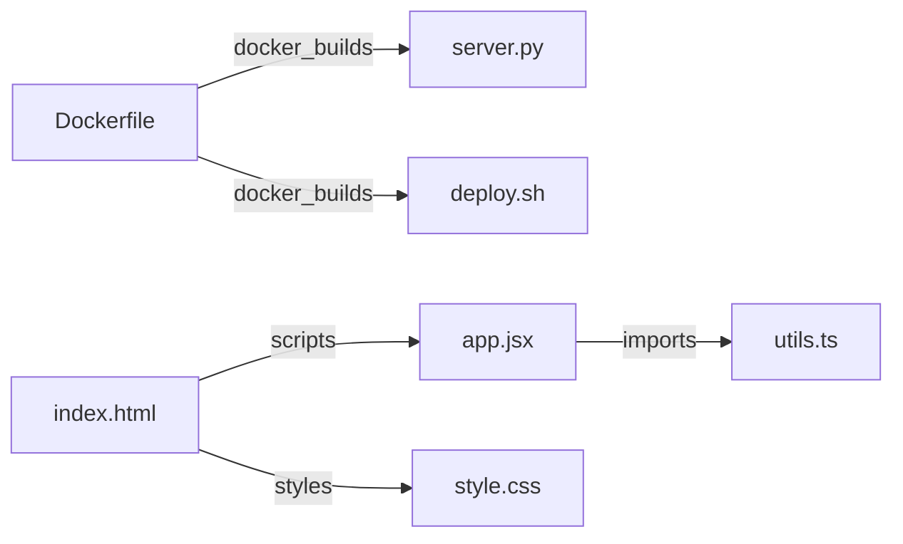

# Codebase Architecture & Technical Index: `samples`
> **Engine Used**: Rule/AST Deep Knowledge Engine (Deterministic Zero-AI Mode)  
> **Scope**: 10 files | 293 lines of code | 5 cross-file interconnections
---

## 🏰 1. The Big Castle Story (Explain Like I'm 4 Years Old)
> Imagine this entire project `samples` is a giant, bustling Lego castle or toy workshop! There are 10 different Lego pieces working together across 10 languages. Some files build the colorful walls and buttons that you see on screen (frontend), some files are the secret clockwork gears under the floor doing the heavy lifting (backend), and 5 plastic snap-connectors hold them tightly together so when you tap a button on the wall, the gears turn and the doors open smoothly!

---

## 2. System Architecture & Tech Stack
### Architectural Style: **Single Page Application (SPA) / Frontend Component Architecture**
The project implements a modern client-side Single Page Application architecture. Components are organized hierarchically, allowing rapid declarative DOM updates via the Virtual DOM and encapsulated CSS styling.

### Technology Compatibility Analysis
**Multi-Language Ecosystem**: The codebase is composed of Dockerfile (1 files), Java (1 files), JavaScript (JSX/React) (1 files), Shell Script (1 files), Rust (1 files), Go (1 files), HTML (1 files), Python (1 files), CSS (1 files), TypeScript (1 files). The frontend leverages modern React declarative components for high-fidelity interactive state management. Styling is streamlined using atomic utility classes compiled ahead of time for minimal production bundle footprint. Environment parity is guaranteed through Docker containerization, ensuring deterministic deployment across local and cloud targets.

| Category | Detected Technologies & Tooling |
| :--- | :--- |
| **Languages** | `Dockerfile` (1 files), `Java` (1 files), `JavaScript (JSX/React)` (1 files), `Shell Script` (1 files), `Rust` (1 files), `Go` (1 files), `HTML` (1 files), `Python` (1 files), `CSS` (1 files), `TypeScript` (1 files) |
| **Frameworks** | `CLI / Tooling Automation (echo, python, export)`, `Docker Engine Containerization`, `Go Standard net/http`, `Pydantic Data Validation`, `React / Modern SPA Mount Point`, `React.js`, `Tailwind CSS Utilities` |
| **Build Tools** | `Docker Container Engine` |
| **Runtimes** | `OCI Containerized Sandbox` |

---

## 3. Directory Subsystem Roles
| Directory / Subsystem | Purpose & Architectural Role |
| :--- | :--- |
| `root/` | Repository Scaffolding, Package Manifests & Environment Configs |

---

## 4. Cross-File Interconnection Graph & Mechanics

### Detailed Interconnection Rationale (How & Why They Work)

#### 🔗 `Dockerfile` ➔ `server.py` (`docker_builds`)
- **Code Reference**: `server.py`
- **How It Works**: The Dockerfile copies `server.py` into the container filesystem via `COPY` or `ADD`. Creates an immutable container layer containing the code needed for runtime execution.
- **Why It Works**: Isolates the application runtime environment, ensuring identical deployment regardless of host OS dependencies.

#### 🔗 `Dockerfile` ➔ `deploy.sh` (`docker_builds`)
- **Code Reference**: `deploy.sh`
- **How It Works**: The Dockerfile copies `deploy.sh` into the container filesystem via `COPY` or `ADD`. Creates an immutable container layer containing the code needed for runtime execution.
- **Why It Works**: Isolates the application runtime environment, ensuring identical deployment regardless of host OS dependencies.

#### 🔗 `app.jsx` ➔ `utils.ts` (`imports`)
- **Code Reference**: `./utils.ts`
- **How It Works**: `app.jsx` imports symbols from `utils.ts` using module syntax `./utils.ts`. The bundler or module loader resolves the file export dictionary and binds exported components or functions into the caller's local scope.
- **Why It Works**: Enforces clean separation of concerns: `utils.ts` encapsulates reusable UI or business logic, allowing `app.jsx` to compose it without code duplication.

#### 🔗 `index.html` ➔ `style.css` (`styles`)
- **Code Reference**: `style.css`
- **How It Works**: The HTML document references `style.css` via `<link rel='stylesheet' href='style.css'>`. The browser engine dispatches an HTTP request, parses the CSS rules, and constructs the CSSOM (CSS Object Model).
- **Why It Works**: Applies visual presentation, responsive layouts, color themes, and typography to the DOM nodes defined in `index.html`.

#### 🔗 `index.html` ➔ `app.jsx` (`scripts`)
- **Code Reference**: `app.jsx`
- **How It Works**: The HTML file loads `app.jsx` via `<script src='app.jsx'>`. The browser script engine compiles and executes the bundle, attaching event listeners and mounting dynamic views into the DOM.
- **Why It Works**: Transforms the static HTML scaffold into an interactive application, initializing state management and dynamic UI lifecycle.

---

## 5. File-by-File Detailed Explanation Catalog
Each file below has its own dedicated, beginner-friendly analysis document:

| File | Language | Lines | Role | Individual Explanation Link |
| :--- | :--- | :---: | :--- | :---: |
| **`Dockerfile`** | `Dockerfile` | 18 | Containerization, Environment Isolation & Deployment Blueprint | [📄 View Explanation](files/Dockerfile.md) |
| **`Service.java`** | `Java` | 19 | Java Enterprise Backend Service / JVM Component | [📄 View Explanation](files/Service.java.md) |
| **`app.jsx`** | `JavaScript (JSX/React)` | 36 | React View Component & Interactive UI Controller | [📄 View Explanation](files/app.jsx.md) |
| **`deploy.sh`** | `Shell Script` | 16 | Build, Automation, CI/CD or Deployment Task Runner | [📄 View Explanation](files/deploy.sh.md) |
| **`engine.rs`** | `Rust` | 35 | Rust Systems Service / High-Performance Core Engine | [📄 View Explanation](files/engine.rs.md) |
| **`handler.go`** | `Go` | 34 | Go Cloud Microservice / High-Performance Backend Routine | [📄 View Explanation](files/handler.go.md) |
| **`index.html`** | `HTML` | 38 | Application Presentation & DOM Root Entrypoint | [📄 View Explanation](files/index.html.md) |
| **`server.py`** | `Python` | 23 | Python Source File | [📄 View Explanation](files/server.py.md) |
| **`style.css`** | `CSS` | 58 | Visual Design Tokens, Layout Styling & Responsive Theming | [📄 View Explanation](files/style.css.md) |
| **`utils.ts`** | `TypeScript` | 16 | JavaScript/TypeScript Logic & Module Utility | [📄 View Explanation](files/utils.ts.md) |

> You can also view the complete consolidated dossier in [FULL_REPORT.md](FULL_REPORT.md) or launch the interactive GUI in [dashboard.html](dashboard.html).
